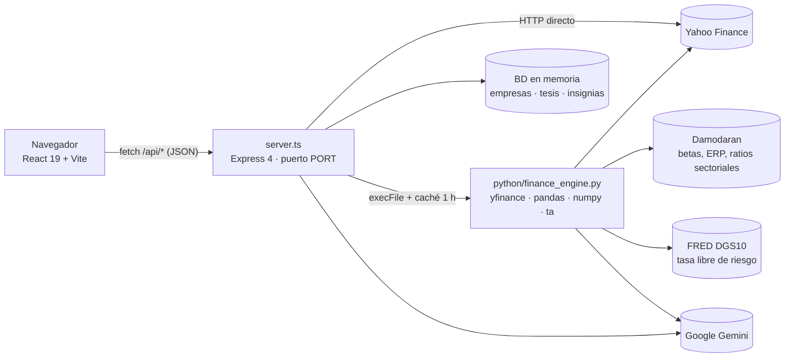

# El Rincón de Warren — Funcionamiento técnico paso a paso

> Documento técnico de la aplicación: arquitectura, flujo de cada módulo, fuentes de datos, cálculos y despliegue.
> Estado del código: rama `main`, octubre de 2026.

---

## 1. Qué es la aplicación

El Rincón de Warren es una plataforma educativa de *Value Investing* para pequeños inversores. Permite analizar empresas cotizadas con datos reales de mercado, consultar a dos asesores de inteligencia artificial (uno fundamental y otro técnico), construir carteras con el modelo de Markowitz y aprender mediante juegos y una ruta de progreso.

Tiene cinco secciones (pestañas):

| Pestaña | Componente principal | Propósito |
|---|---|---|
| Análisis fundamental | `FundamentalEngine.tsx` | Ratios, gráfico, CAPM, consenso de analistas y asesores IA |
| Simulador | `PortfolioSimulator.tsx` + `MarkowitzOptimizer.tsx` | Cartera simulada y frontera eficiente |
| Gamificación | `GamificationHub.tsx` | Juegos, tesis de la comunidad, liga y ruta de aprendizaje |
| Evaluación de impacto | `ImpactEvaluationDashboard.tsx` | Modelo de Diferencias en Diferencias (DiD) |
| Metodología | `MethodologyDocumentation.tsx` | Documentación metodológica |

Además existen dos modos de vista (`ViewModeContext.tsx`): **Simple**, para principiantes, que oculta el simulador y la evaluación de impacto, y **Analista**, con todas las herramientas.

---

## 2. Arquitectura



| Capa | Tecnología | Responsabilidad |
|---|---|---|
| Frontend | React 19, TypeScript 5.8, Vite 6, TailwindCSS 4, `lightweight-charts`, `recharts`, `lucide-react`, `motion` | Interfaz, estado de la sesión, gráficos |
| Backend | Express 4 en `server.ts` (ejecutado con `tsx` en desarrollo y como `dist/server.cjs` en producción) | API REST, caché, timeouts, orquestación |
| Motor de datos | Python 3.12, `python/finance_engine.py` | Descarga de datos reales y cálculo cuantitativo |
| IA | Google Gemini (`@google/genai` y `google-genai`) | Asesores Jairo y Juan Guillermo, patrones técnicos, clasificación sectorial |

Un único proceso Node sirve la API y el frontend: en desarrollo monta Vite como middleware; en producción sirve la carpeta `dist/`.

---

## 3. Arranque de la aplicación

1. **Servidor.** `npm run dev` ejecuta `tsx server.ts`. El servidor:
   - carga las variables de `.env` (`GEMINI_API_KEY`);
   - inicializa la base de datos en memoria con las empresas semilla de `src/data/initialData.ts`;
   - registra todos los endpoints `/api/*`;
   - escucha en `process.env.PORT` (3000 por defecto).
2. **Frontend.** El navegador carga `index.html` → `src/main.tsx` → `App.tsx`.
3. **Catálogo inicial.** `App.tsx` llama a `GET /api/companies`. El servidor calcula los ratios de cada empresa semilla con `analyzeCompany()` y devuelve el catálogo analizado; la primera empresa queda seleccionada.
4. **Primera visita.** Se muestra `OnboardingFlow` y se calcula el índice de motivación inicial (`GET /api/gamification/motivation`).

> La base de datos es **en memoria**: las empresas importadas, tesis e insignias se pierden al reiniciar el servidor.

---

## 4. Cómo viaja un dato: del navegador a Yahoo Finance y de vuelta

Este es el recorrido común a casi todas las herramientas que usan datos de mercado:

1. **Componente React.** El componente llama a `fetchJson()` o `postJson()` (`src/utils/api.ts`), que añade un límite de tiempo en el cliente (35 s para datos, 50 s para asesores y 65 s para patrones).
2. **Endpoint Express.** El endpoint valida los parámetros y llama a `runPythonEngine([comando, ...argumentos])`.
3. **Caché del servidor.** `runPythonEngine` busca la clave (comando + argumentos) en un `Map` en memoria:
   - si existe y no ha caducado, responde al instante;
   - si otra petición idéntica está en curso, espera a esa misma (no lanza un segundo proceso);
   - si no, ejecuta Python.
4. **Subproceso Python.** `execFile("python3", ["python/finance_engine.py", comando, ...args])` con un límite de **25 s**. El script escribe **solo JSON** por la salida estándar; los registros de diagnóstico van por la salida de error.
5. **Motor Python.** Descarga los datos con `yfinance`, calcula con `pandas`/`numpy` y devuelve el resultado.
6. **Respuesta.** Si el resultado es correcto, se guarda en caché y se devuelve. Si no, el servidor responde con un error estructurado (sección 12).
7. **Interfaz.** El componente muestra los datos o el mensaje de error y libera siempre el estado de carga.

### Tiempos de caché

| Dato | Dónde | Duración |
|---|---|---|
| Respuestas de Python (empresa, velas, CAPM, consenso, noticias, Markowitz…) | Memoria del servidor | 1 hora |
| Cotización en vivo | Memoria del servidor | 60 segundos |
| Datos completos de una empresa (`get_company_data`) | Disco: `python/cache/company_<TICKER>.json` | 1 hora |
| Betas, ratios sectoriales y ERP de Damodaran, tasa del bono a 10 años | Disco: `python/cache/` | 4 h a 7 días |

Solo se cachean respuestas correctas; un error nunca se guarda.

---

## 5. Módulo de análisis fundamental, paso a paso

### 5.1 Buscar e importar una empresa

1. El usuario escribe en el buscador. Tras 200 ms sin teclear, se llama a `GET /api/market/search?q=…`.
2. El servidor combina cuatro fuentes: el catálogo cargado, el catálogo de balances auditados (`popularTickersData.ts`), un directorio de nombres y alias (por ejemplo "coca cola" → KO) y la búsqueda en vivo de Yahoo Finance.
3. Al elegir un resultado se llama a `POST /api/market/import`:
   - **Ya está en el catálogo:** se actualiza su cotización en vivo.
   - **Está en el catálogo de balances auditados:** se añade con esos balances y la cotización en vivo.
   - **Cualquier otro ticker:** se ejecuta el comando Python `company`, que descarga los estados financieros reales. Si Yahoo no devuelve cotización o estados financieros, la importación **se rechaza con un error** (no se crea ninguna empresa con cifras estimadas).

### 5.2 Descarga de datos de la empresa (`company`)

`get_company_data(ticker)` en Python:

1. Revisa la caché en disco (1 hora).
2. Descarga `info`, balance, cuenta de resultados y flujos de caja con `yfinance`.
3. Exige una cotización real y estados financieros publicados; si faltan, devuelve `success: false`.
4. Convierte las partidas a millones de USD y calcula ratios: liquidez, prueba ácida, endeudamiento, cobertura de intereses, ROE, ROA, BPA, PER, precio/valor contable, rentabilidad por dividendo y descomposición DuPont.
5. Clasifica la industria con Gemini y obtiene los benchmarks sectoriales de Damodaran.
6. Obtiene el consenso de precio objetivo de los analistas.
7. Calcula el bloque de **valoración** (`calcular_valoracion`):
   - múltiplos PER, EV/EBITDA, precio/valor contable y precio/flujo de caja libre;
   - márgenes y crecimiento interanual;
   - deuda neta/EBITDA;
   - **ROIC** = EBIT × (1 − t) / (deuda + patrimonio − caja);
   - **K_e** por CAPM y **WACC** ponderado a valor de mercado;
   - **DCF de referencia**: flujo libre medio de hasta 3 ejercicios, 5 años de crecimiento (el crecimiento de ingresos, acotado entre 2% y 12%), 2.5% perpetuo, descontado al WACC. En entidades financieras no se calcula.

### 5.3 Ratios y puntuación S(a)

El servidor recalcula los ratios en TypeScript (`calculateFundamentalRatios`) y asigna un semáforo a cada uno:

| Dimensión | Ratios | Verde si… |
|---|---|---|
| Liquidez | Liquidez corriente · Prueba ácida · Disponibilidad inmediata | ≥ 1.5x · ≥ 0.8x · ≥ 0.3x |
| Solvencia | Endeudamiento (pasivo/patrimonio) · Cobertura de intereses | ≤ 1.0x · ≥ 5x |
| Rentabilidad | ROA · ROE | ≥ 8% · ≥ 15% |
| Valoración | BPA · PER · Precio/valor contable · Rentabilidad por dividendo | > 0 · ≤ 18x · ≤ 2.5x · ≥ 2.5% |

Después calcula la puntuación lineal (`calculateLinearScore`):

```
S(a) = 0.20 · Liquidez + 0.25 · Solvencia + 0.25 · Rentabilidad + 0.30 · Valoración
```

Cada dimensión se normaliza de 0 a 100. La nota final va de A+ (≥ 90) a F (< 40).

### 5.4 Gráfico de cotización

1. `CompanyPriceChart` pide `GET /api/python/candles/:ticker?period=…&interval=…`.
2. Python descarga las velas y calcula EMA 20, 50 y 200, RSI (14) y MACD (12/26/9).
3. Si falla, el gráfico intenta `GET /api/market/history/:ticker`, que lee el histórico directamente de Yahoo (sin indicadores). Si también falla, se muestra el error.
4. La línea de precio objetivo solo se dibuja si existe consenso real de analistas; si no, se muestra "N/D".
5. **Patrones técnicos:** el botón de análisis envía las velas reales a `POST /api/market/technical-patterns/:ticker`. Gemini identifica soportes, resistencias y pisos o techos múltiples y los cruza con EMA 200, RSI y MACD. Si Gemini no responde, el servidor calcula los niveles directamente a partir de los mínimos, máximos y la media de esas mismas velas.

### 5.5 Costo de capital (CAPM)

`CapmValuationCard` llama a `GET /api/python/capm/:ticker`:

```
K_e = tasa libre de riesgo + β × prima de riesgo de mercado
```

| Componente | Fuente |
|---|---|
| Tasa libre de riesgo | Bono del Tesoro de EE. UU. a 10 años (FRED, serie DGS10) |
| β (beta) | Beta de la industria de Damodaran, emparejando la industria de Yahoo con la de Damodaran |
| Prima de riesgo | Prima implícita de Damodaran (*Implied ERP, FCFE*), último año publicado |

La tarjeta permite mover la prima de riesgo y alternar entre beta apalancada y desapalancada, y compara el K_e con el ROE de la empresa para indicar si crea o destruye valor.

### 5.6 Tracking Error

`TrackingErrorCard` llama a `GET /api/python/tracking-error/:ticker?benchmark=^GSPC&period=1y`. Python descarga los precios de la acción y del índice, calcula los rendimientos diarios activos (acción − índice) y devuelve:

- error de seguimiento diario y anualizado (desviación típica × √252);
- rendimiento activo anualizado;
- ratio de información (rendimiento activo / error de seguimiento);
- estilo de gestión según la magnitud del error.

### 5.7 Consenso de Wall Street

`WallStreetConsensus` lanza en paralelo tres consultas: precios objetivo (`/targets`), recomendaciones de analistas (`/recommendations`) y noticias recientes (`/news`). Cada bloque se muestra si su fuente respondió; si fallan las tres, se muestra el motivo.

---

## 6. Asesores de IA: Jairo y Juan Guillermo

| Asesor | Especialidad | Datos que recibe |
|---|---|---|
| Jairo Agudelo | Análisis fundamental y valoración | Ratios, ROIC frente a WACC, múltiplos, flujo libre, DCF de referencia, consenso |
| Juan Guillermo "Guangui" Hernández | Análisis técnico y operativa | Precio, EMA 20/50/200, RSI, MACD, soporte, resistencia, rango de 52 semanas, volatilidad, ATR, volumen y relación riesgo/beneficio |

### 6.1 Consulta puntual

1. El usuario escribe una pregunta y pulsa "Preguntar a Jairo" o "Preguntar a Guangui".
2. El componente (`JairoGuillermoConsult.tsx`) detecta la empresa (seleccionada o mencionada en el texto) y envía `POST /api/python/consulta-jairo` o `consulta-guillermo`.
3. Python reúne los datos reales de la empresa. **Si no consigue datos reales, devuelve un error y no genera respuesta.**
4. Construye el *prompt* de sistema: perfil del asesor (`python/data/perfil_*.txt`), reglas de respuesta y bloque de datos.
5. Llama a Gemini con una cadena de modelos de respaldo (`MODELOS_ASESORES`) y un límite de 20 s por modelo.
6. El servidor devuelve la respuesta con su fuente (`gemini-live` o `motor-analitico`).

**Estado aislado por asesor:** cada asesor tiene su propio chat (pregunta, respuesta, carga y error). Una consulta a uno nunca escribe en la tarjeta del otro, y un identificador de petición descarta las respuestas que llegan tarde.

### 6.2 Diagnóstico general

`POST /api/python/consulta-dual` lanza **en paralelo** las dos consultas con una estructura fija (Jairo: negocio, calidad, balance, valoración y veredicto; Guillermo: tendencia, impulso, niveles, plan y veredicto). Después, una tercera llamada actúa como moderador: declara si las visiones **coinciden** o **divergen** y resuelve con el criterio "el fundamental decide qué comprar; el técnico, cuándo".

### 6.3 Reglas de respuesta

Los *prompts* exigen que la primera frase responda la pregunta con una posición clara, que se usen solo cifras del contexto (mostrando las cuentas propias), que se nombre el riesgo que invalida la conclusión y que se cierre con una acción concreta. La salida es texto plano, porque la interfaz no interpreta Markdown.

---

## 7. Simulador de cartera y Markowitz

1. **Operaciones simuladas.** El usuario compra y vende acciones del catálogo; el estado de la cartera vive en `App.tsx`.
2. **Análisis de riesgo.** `POST /api/portfolio/analyze` calcula rendimiento medio, volatilidad muestral y ratio de Sharpe, y detecta sesgos de conducta (por ejemplo, sobreoperativa con más de 6 transacciones).
3. **Optimizador de Markowitz** (dos implementaciones):
   - **En el navegador** (`src/utils/markowitz.ts`): construye las matrices de correlación y covarianza, genera carteras aleatorias (distribución de Dirichlet), traza la frontera eficiente y localiza la cartera de máximo Sharpe. Usa rendimientos y volatilidades **predefinidos** para las empresas semilla y **estimados a partir de ROE, dividendo y deuda** para el resto.
   - **En Python** (`POST /api/python/markowitz`, desde la consola Python): descarga un año de precios reales con `yfinance` y calcula covarianzas y correlaciones empíricas. Los gráficos de Seaborn y Matplotlib se generan con `POST /api/python/plots`.

---

## 8. Gamificación

- **Juegos:** identificar el foso económico, margen de seguridad, reto de Markowitz y sesgos cognitivos (`src/components/gamification/`).
- **Experiencia (XP) y niveles:** nivel 2 a partir de 500 XP y nivel 3 a partir de 1000 XP.
- **Tesis de la comunidad:** `GET/POST /api/theses` y votos con `POST /api/theses/:id/upvote`.
- **Índice de motivación:** `GET /api/gamification/motivation` aplica un modelo lineal con coeficientes fijos (colaboración 0.320, recompensas 0.307, multijugador 0.239, progreso 0.235, retroalimentación 0.151, intercepto 12.5) y lo normaliza de 0 a 100.

---

## 9. Evaluación de impacto (DiD)

`GET /api/admin/did-evaluation` aplica Diferencias en Diferencias a varias métricas (rotación de cartera, ratio de Sharpe, margen de seguridad):

```
β₃ = (Tratamiento_post − Tratamiento_pre) − (Control_post − Control_pre)
```

> Los valores de los grupos de control y tratamiento están **escritos en el código como un ensayo simulado**, y el error estándar y el valor p se derivan de reglas fijas, no de una estimación sobre datos de usuarios. El módulo ilustra el diseño de evaluación; no es un resultado empírico. Ver sección 14.

---

## 10. Herramientas transversales

| Herramienta | Qué hace |
|---|---|
| Búsqueda tipo Spotlight (Cmd/Ctrl + K) | Busca empresas y secciones desde cualquier pantalla |
| Consola de datos Python | Ejecuta en vivo la extracción de una empresa, Markowitz y gráficos, mostrando el registro paso a paso |
| Visor de base de datos y código | Muestra el esquema SQL/NoSQL de referencia y los scripts (`/api/schema-and-scripts`) |
| Retroalimentación instantánea | Avisos pedagógicos cuando se detecta un sesgo de conducta |

---

## 11. Referencia de la API

| Método y ruta | Fuente | Uso |
|---|---|---|
| `GET /api/companies` | Memoria | Catálogo analizado |
| `POST /api/companies/calculate` | Cálculo local | Ratios de una empresa introducida a mano |
| `GET /api/market/search?q=` | Catálogo + Yahoo | Búsqueda de empresas |
| `POST /api/market/import` | Yahoo / Python `company` | Añadir empresa al catálogo |
| `POST /api/market/sync-prices` | Yahoo | Actualizar cotizaciones del catálogo (en paralelo) |
| `GET /api/market/quote/:ticker` | Yahoo | Cotización en vivo |
| `GET /api/market/history/:ticker` | Yahoo | Histórico de precios (respaldo del gráfico) |
| `POST /api/market/technical-patterns/:ticker` | Gemini | Patrones técnicos |
| `GET /api/python/company/:ticker` | Python | Estados financieros, ratios y valoración |
| `GET /api/python/candles/:ticker` | Python | Velas e indicadores |
| `GET /api/python/targets/:ticker` | Python | Precios objetivo de analistas |
| `GET /api/python/recommendations/:ticker` | Python | Recomendaciones de analistas |
| `GET /api/python/news/:ticker` | Python | Noticias |
| `GET /api/python/capm/:ticker` | Python | Costo de capital |
| `GET /api/python/tracking-error/:ticker` | Python | Error de seguimiento |
| `GET /api/python/classify-industry/:ticker` | Python + Gemini | Industria de Damodaran |
| `POST /api/python/markowitz` · `POST /api/python/plots` | Python | Optimización y gráficos |
| `POST /api/python/consulta-jairo` · `consulta-guillermo` · `consulta-dual` | Python + Gemini | Asesores de IA |
| `POST /api/portfolio/analyze` | Cálculo local | Riesgo y sesgos de la cartera |
| `GET /api/gamification/motivation` | Cálculo local | Índice de motivación |
| `GET/POST /api/theses` · `POST /api/theses/:id/upvote` | Memoria | Tesis de la comunidad |
| `GET /api/admin/did-evaluation` | Datos simulados | Evaluación de impacto |

`/api/market/{targets,recommendations,news,capm}/:ticker` son alias de las rutas `/api/python/…` equivalentes.

---

## 12. Manejo de errores

Principio: **ante un fallo no se muestran datos estimados ni ficticios**; se informa el error.

| Situación | Respuesta del servidor |
|---|---|
| Python o Yahoo superan 25 s (45 s en los asesores) | HTTP 504 · `{ success: false, error: true, message: "Tiempo de espera agotado al consultar la fuente financiera. Reintenta la búsqueda." }` |
| El motor informa que no hay datos (ticker inexistente, sin estados financieros, sin precios) | HTTP 502 con el motivo concreto |
| Python no está instalado o falta una librería | HTTP 502 indicando qué falta |
| Yahoo limita las peticiones (error 429) | HTTP 502 indicándolo |

En el frontend, `fetchJson` convierte cualquiera de estos casos en una excepción con el mensaje legible. Cada componente lo muestra en pantalla y libera su estado de carga en un bloque `finally`, de modo que ningún botón queda bloqueado.

---

## 13. Ejecución y despliegue

### Local

```bash
npm install
pip install -r requirements.txt
# .env en la raíz con GEMINI_API_KEY=...
npm run dev            # http://localhost:3000
npm run lint           # verificación de tipos (tsc --noEmit)
python python/finance_engine.py test   # comprueba las librerías de Python
```

### Producción (Render)

| Ajuste | Valor |
|---|---|
| Comando de build | `./.render-build.sh` (instala Node y Python y ejecuta `npm run build`) |
| Comando de arranque | `npm start` → `node dist/server.cjs` |
| Variables de entorno | `NODE_ENV=production`, `GEMINI_API_KEY`, `PYTHON_VERSION=3.12.10` |

`npm run build` compila el frontend con Vite en `dist/` y empaqueta el servidor con esbuild en `dist/server.cjs`. El servidor escucha en el puerto que asigna la plataforma (`PORT`).

---

## 14. Limitaciones conocidas

- **Persistencia:** la base de datos vive en memoria; se reinicia con el servidor.
- **Empresas semilla:** sus balances y precios objetivo están fijados en `src/data/initialData.ts` y pueden estar desactualizados frente al mercado. Las empresas importadas sí usan datos reales.
- **Markowitz en el navegador:** usa rendimientos y volatilidades predefinidos o estimados, no históricos. La versión Python sí usa precios reales.
- **Evaluación de impacto y motivación:** los datos del ensayo DiD, el error estándar, el valor p y los estadísticos de validación (R², alfa de Cronbach, KMO) son valores fijos de demostración.
- **Dependencia de Yahoo Finance:** `yfinance` no es una API oficial; puede cambiar o limitar peticiones, sobre todo desde servidores en la nube.
- **Código sin usar:** `src/routes/` y `src/services/` duplican lógica de `server.ts` y no se cargan. El motor de plantillas `src/utils/dualAdvisorEngine.ts` ya no se usa como respaldo de los asesores; solo se aprovecha `identifyCompany`.
- **Sin pruebas automatizadas:** la única verificación es `npm run lint`.

---

## 15. Mapa de archivos clave

```
server.ts                         API Express, caché, timeouts, errores y servidor de la SPA
python/finance_engine.py          Motor de datos (CLI: <comando> <args> → JSON)
python/data/perfil_*.txt          Perfiles de los asesores
python/cache/                     Caché en disco (Damodaran, FRED, empresas)
src/App.tsx                       Estado global y navegación por pestañas
src/utils/api.ts                  Cliente HTTP con timeout y errores legibles
src/utils/financialCalculations.ts  Ratios, puntuación S(a), Sharpe, motivación y DiD
src/utils/markowitz.ts            Optimizador de Markowitz en el navegador
src/components/                   Componentes de cada módulo
src/data/                         Empresas semilla, catálogos, fórmulas y datos de juegos
requirements.txt                  Dependencias de Python
.render-build.sh                  Script de build para Render
```
